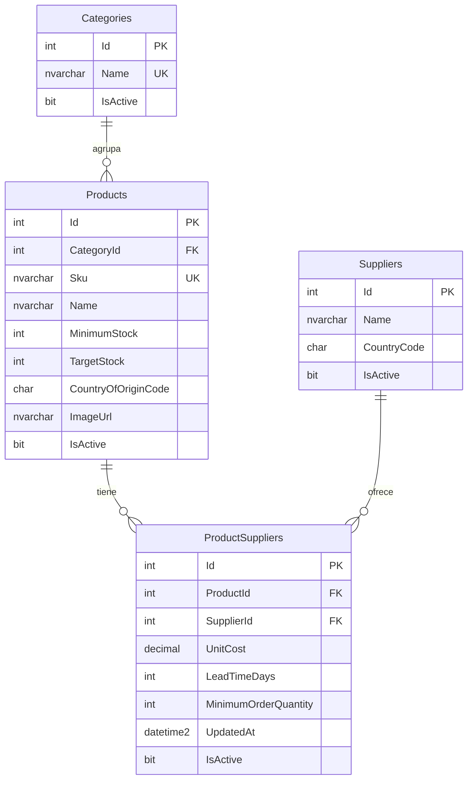
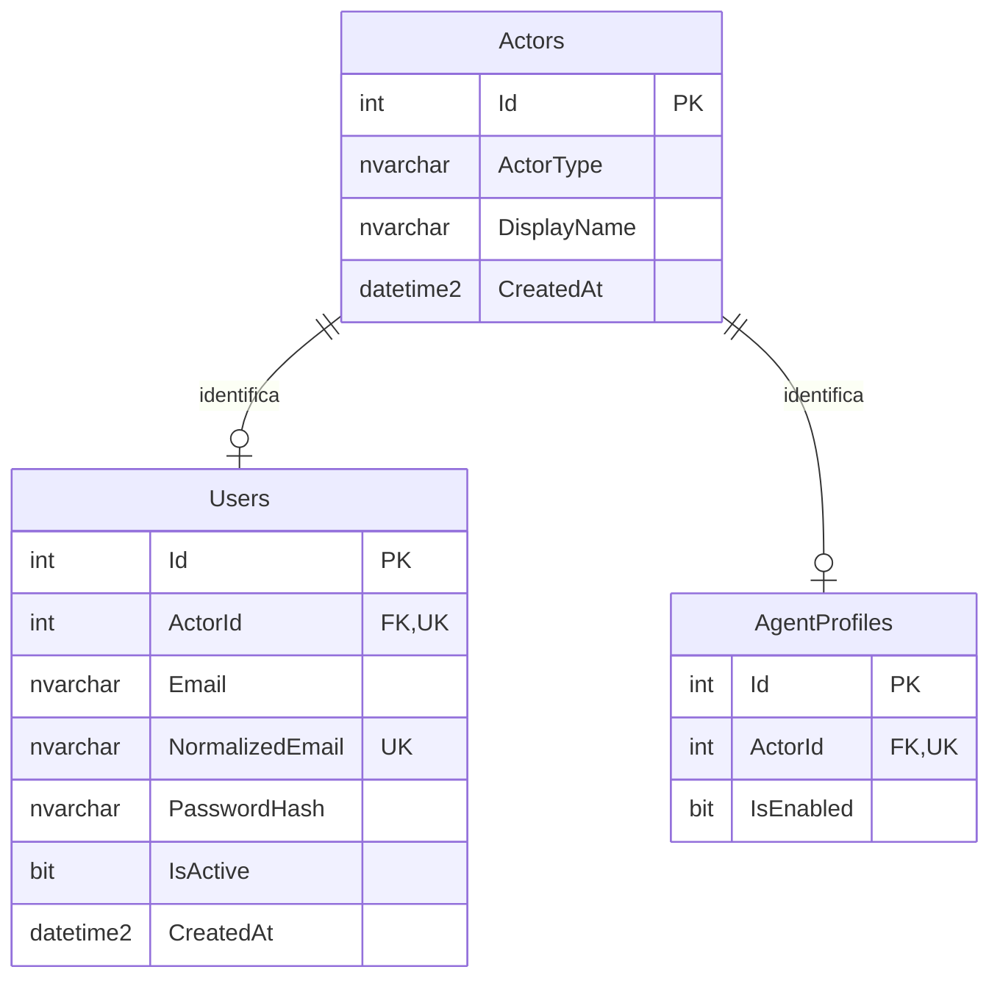
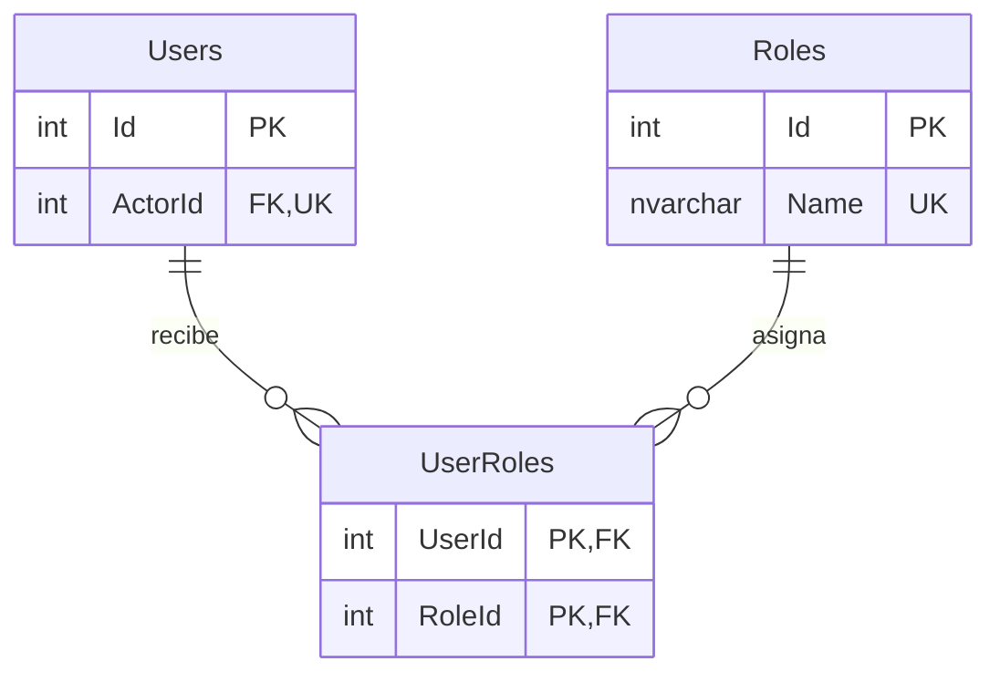
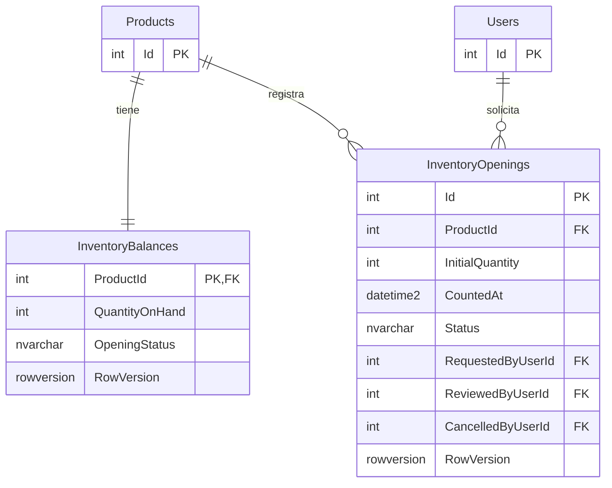

# Diagrama entidad-relación — Abastece

Estado: diseño inicial de catálogo, identidades y acceso.
Los campos completos se describen en data-dictionary.md.

## 1. Catálogo y proveedores

### Restricciones adicionales

- ProductId + SupplierId es una combinación única.
- TargetStock debe ser mayor que MinimumStock.
- Los costos deben ser mayores que cero.
- Cada producto pertenece a una categoría.
- Un producto puede existir sin proveedores asociados.

## 2. Identidades y perfiles

### Restricciones adicionales

- Cada actor corresponde exactamente a un usuario o a un agente,
  nunca a ambos.
- ActorType debe coincidir con el perfil relacionado.
- El actor y su perfil se crean en una misma transacción.
- El diagrama muestra las relaciones individuales; la exclusividad
  y la existencia de un perfil requieren validaciones adicionales.

## 3. Asignación de roles

Users es la misma entidad presentada en el diagrama anterior.

### Restricciones adicionales

- UserRoles tiene una clave primaria compuesta por UserId + RoleId.
- Un usuario puede tener cero o varios roles.
- Tener una cuenta sin roles no concede permisos de negocio.
- Los roles son predefinidos en la primera versión.

## 4. Saldo y apertura de inventario

### Restricciones adicionales

- Cada producto tiene exactamente una fila de saldo, creada
  en la misma transacción que el producto.
- Un producto puede tener varias solicitudes de apertura históricas.
- Solo puede tener una solicitud pendiente y una apertura aplicada
  como máximo.
- RequestedByUserId identifica al solicitante.
- ReviewedByUserId es opcional mientras no exista una revisión.
- CancelledByUserId es opcional y solo se informa al cancelar.
- Los tres campos de responsable referencian Users.Id.
- Para simplificar el dibujo, se muestra únicamente la relación
  del solicitante con Users.
- Los campos completos se describen en data-dictionary.md.