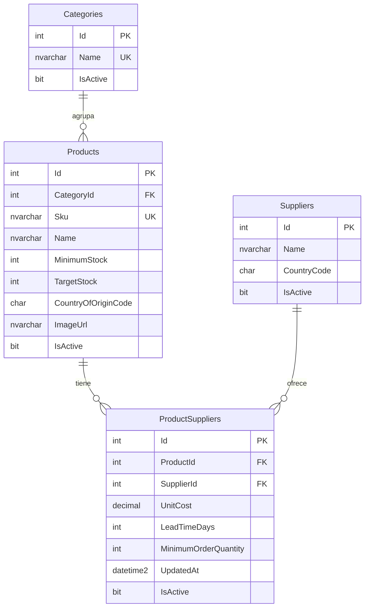
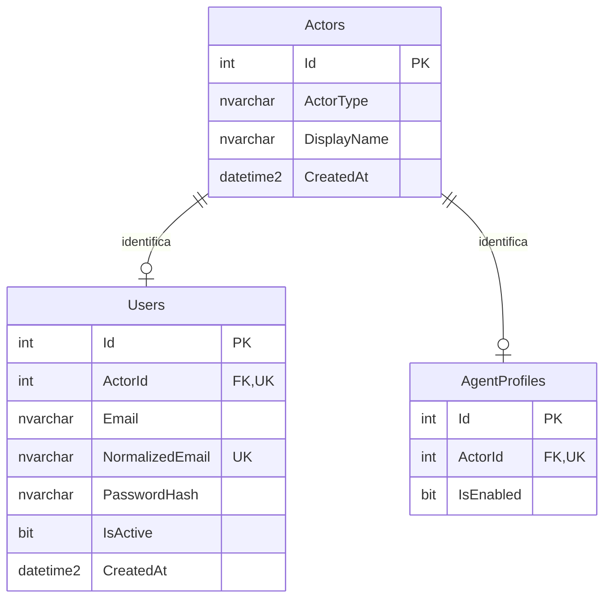
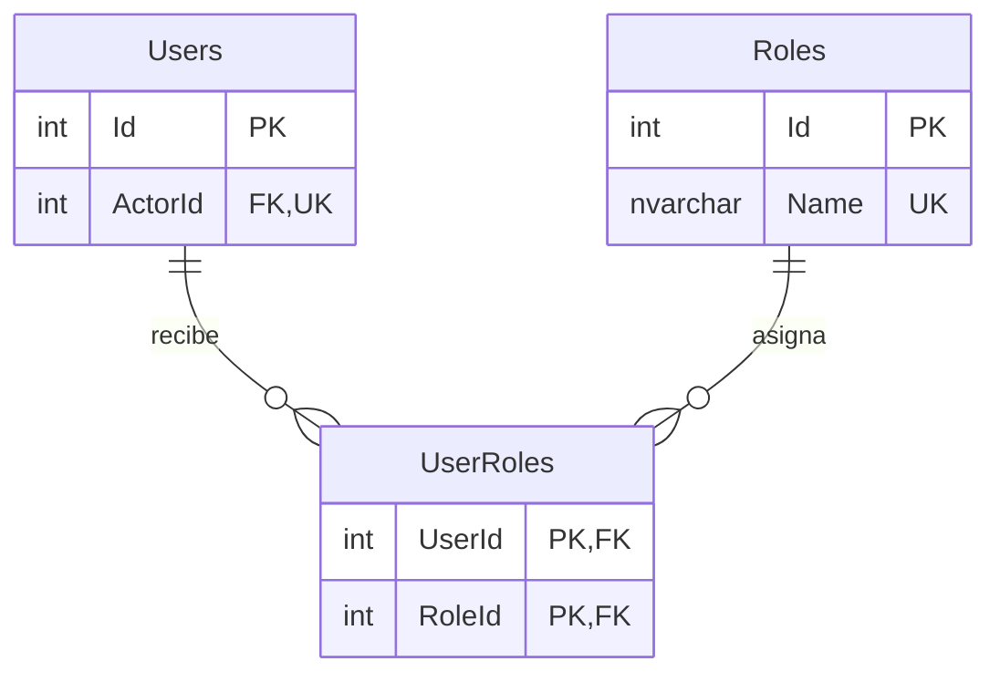
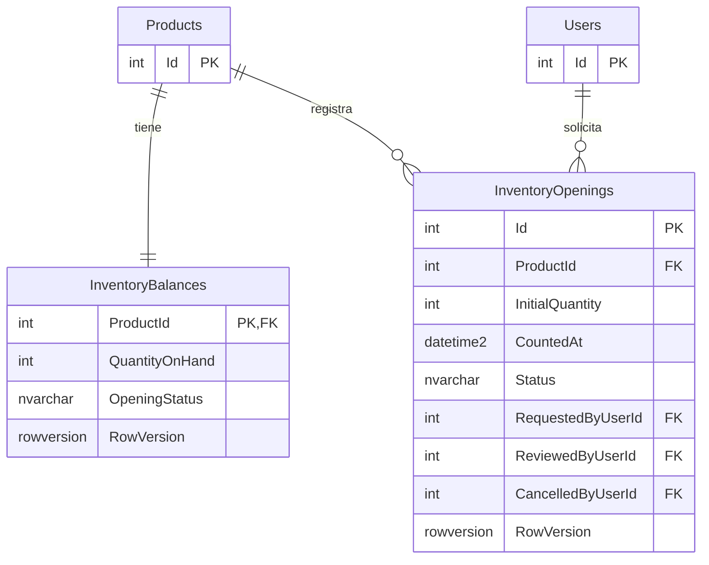
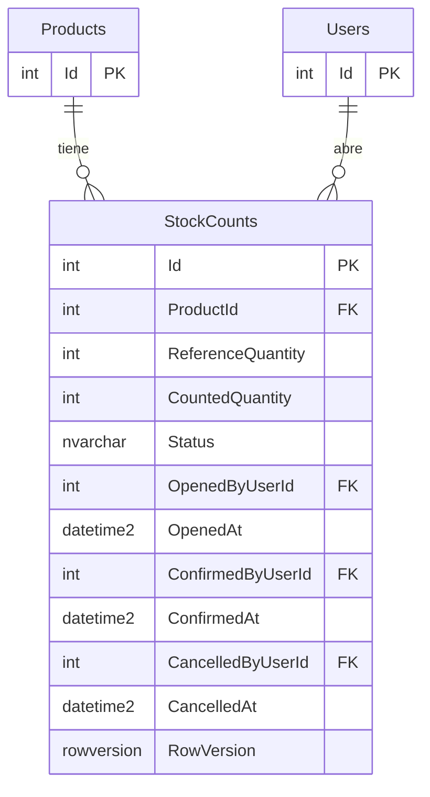
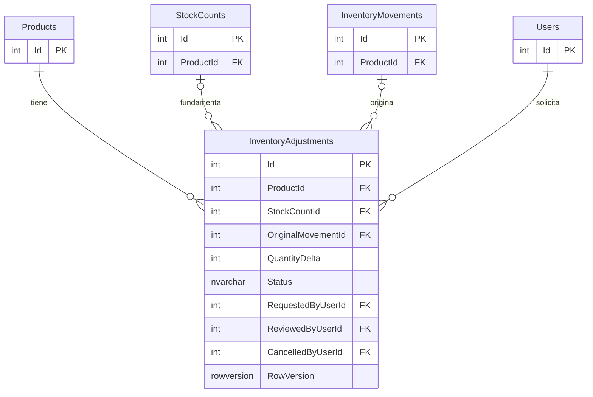
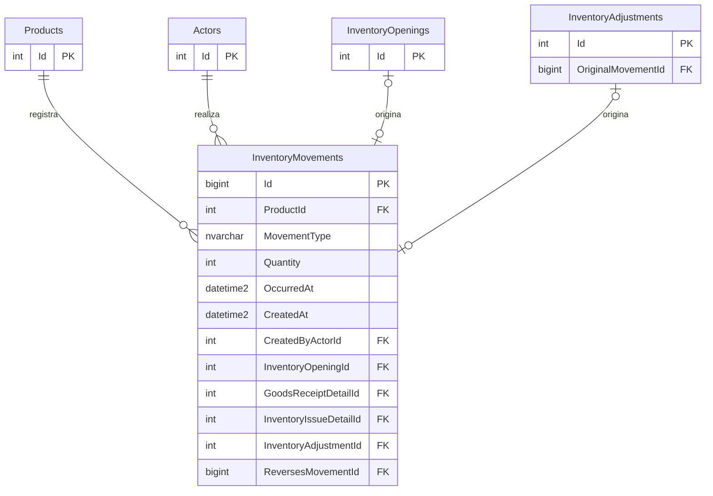
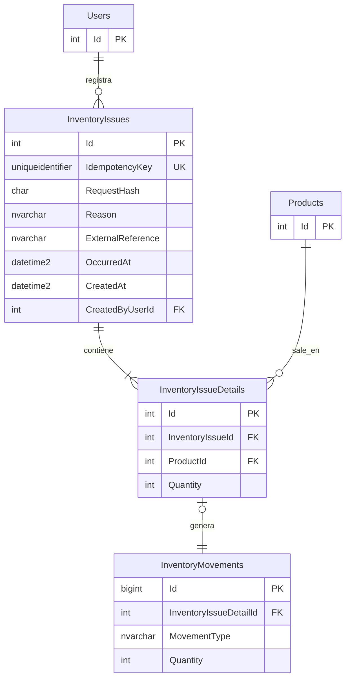
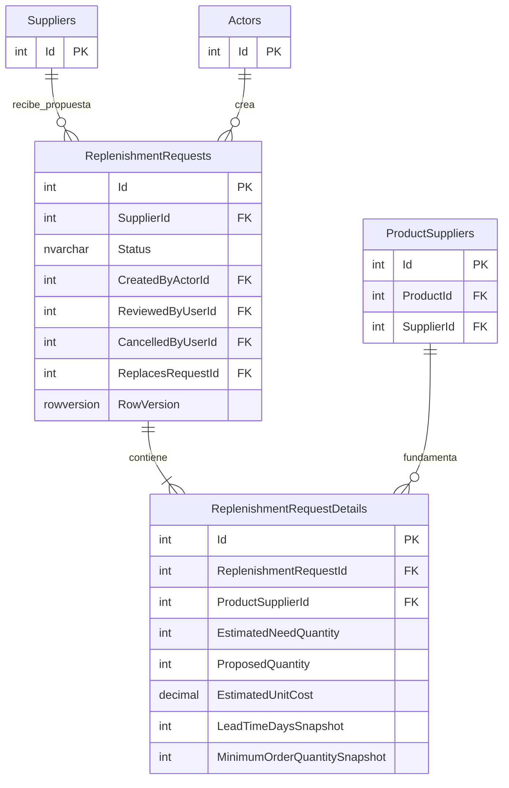

# Diagrama entidad-relación — Abastece

Estado: diseño inicial de catálogo, identidades y acceso.
Los campos completos se describen en data-dictionary.md.

## 1. Catálogo y proveedores



### Restricciones adicionales

- ProductId + SupplierId es una combinación única.
- TargetStock debe ser mayor que MinimumStock.
- Los costos deben ser mayores que cero.
- Cada producto pertenece a una categoría.
- Un producto puede existir sin proveedores asociados.

## 2. Identidades y perfiles



### Restricciones adicionales

- Cada actor corresponde exactamente a un usuario o a un agente,
  nunca a ambos.
- ActorType debe coincidir con el perfil relacionado.
- El actor y su perfil se crean en una misma transacción.
- El diagrama muestra las relaciones individuales; la exclusividad
  y la existencia de un perfil requieren validaciones adicionales.

## 3. Asignación de roles

Users es la misma entidad presentada en el diagrama anterior.



### Restricciones adicionales

- UserRoles tiene una clave primaria compuesta por UserId + RoleId.
- Un usuario puede tener cero o varios roles.
- Tener una cuenta sin roles no concede permisos de negocio.
- Los roles son predefinidos en la primera versión.

## 4. Saldo y apertura de inventario



### Restricciones adicionales

- Cada producto tiene exactamente una fila de saldo, creada
  en la misma transacción que el producto.
- Un producto puede tener varias solicitudes de apertura históricas.
- Solo puede tener una solicitud pendiente y una apertura aplicada
  como máximo.
- RequestedByUserId identifica al solicitante.
- ReviewedByUserId es opcional mientras no exista una revisión.
- CancelledByUserId es opcional y solo se informa al cancelar.
- Los tres campos de responsable referencian Users.Id.
- Para simplificar el dibujo, se muestra únicamente la relación
  del solicitante con Users.
- Los campos completos se describen en data-dictionary.md.

## 5. Conteos físicos



Los responsables de apertura, confirmación y cancelación
referencian Users.Id. Solo se dibuja la relación de apertura
para simplificar la vista.

Solo puede existir un conteo abierto por producto.
Los campos completos y restricciones están en el diccionario.

## 6. Ajustes de inventario



### Restricciones adicionales

- Cada ajuste referencia exactamente un origen: conteo o movimiento.
- El origen debe corresponder al mismo producto del ajuste.
- Un conteo puede tener solicitudes históricas rechazadas o canceladas,
  pero como máximo una pendiente y una aplicada.
- Un movimiento puede tener varias correcciones, siempre respetando
  la cantidad máxima que puede compensarse.
- Las relaciones opcionales del dibujo no expresan por sí solas
  la exclusividad entre ambos orígenes.
- Solo se dibuja la relación del solicitante para simplificar.
  Revisor y responsable de cancelación también referencian Users.Id.
- InventoryMovements se presenta como referencia parcial;
  su estructura completa se documentará posteriormente.

## 7. Movimientos de inventario



### Restricciones adicionales

- Cada movimiento tiene un producto, un actor y exactamente
  un documento de origen.
- Los documentos de origen posibles son apertura, detalle
  de recepción, detalle de salida o ajuste.
- Cada documento de origen genera como máximo un movimiento.
- Una apertura con cero unidades no genera movimiento.
- Un ajuste aplicado genera exactamente un movimiento.
- Las relaciones con detalles de recepción y salida se dibujarán
  al incorporar esas entidades.
- OriginalMovementId identifica el movimiento que motivó
  una solicitud de corrección.
- ReversesMovementId identifica el movimiento compensado
  por una corrección aplicada.
- Las referencias al movimiento original y las restricciones
  entre tipos y orígenes se describen en el diccionario.
- Para simplificar esta vista, no se dibujan las relaciones
  al movimiento original.


## 8. Salidas de inventario



### Restricciones adicionales

- Una salida confirmada contiene uno o varios detalles.
- InventoryIssueId + ProductId es una combinación única.
- Cada detalle genera exactamente un movimiento SaleIssue.
- Un movimiento puede no tener detalle de salida porque puede
  originarse en una apertura, recepción o ajuste.
- InventoryMovements.InventoryIssueDetailId es opcional y único
  cuando tiene valor.
- Cabecera, detalles, movimientos y actualización de saldos
  se confirman en una misma transacción.
- No se permiten salidas parciales implícitas.


## 9. Solicitudes de reposición



### Restricciones adicionales

- Cada solicitud pertenece a un proveedor y contiene al menos un detalle.
- El proveedor de cada ProductSupplierId debe coincidir con el
  SupplierId de la cabecera.
- ReplenishmentRequestId + ProductSupplierId es una combinación única.
- CreatedByActorId permite identificar a un creador humano o agente.
- ReviewedByUserId y CancelledByUserId referencian Users.Id.
- ReplacesRequestId referencia una solicitud anterior de la misma tabla.
- Las relaciones de revisión, cancelación y reemplazo no se dibujan
  para simplificar esta vista.
- Las condiciones copiadas en el detalle conservan lo presentado
  al gerente, aunque cambie el catálogo.
- Los campos completos se describen en el diccionario de datos.
```


